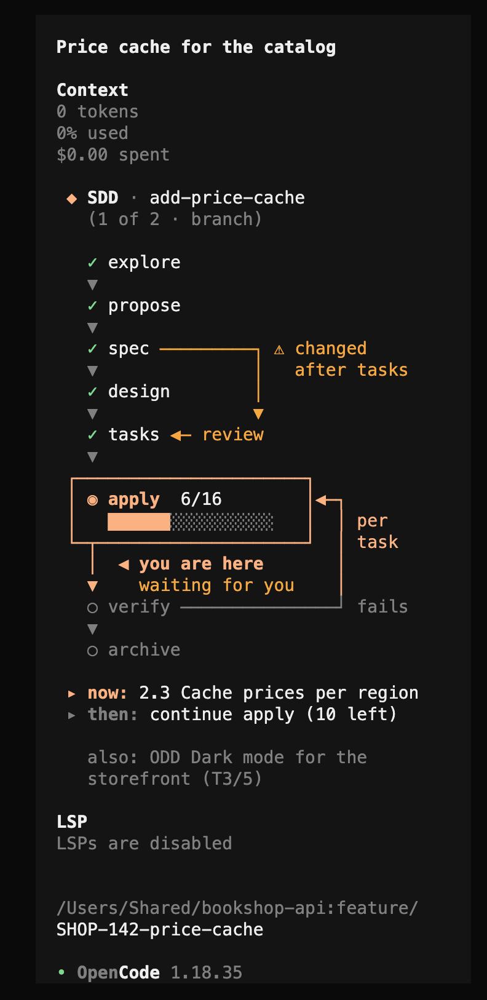

# opencode-openspec-status

A read-only [OpenCode](https://opencode.ai) TUI plugin that draws, in the right
sidebar, where your OpenSpec (SDD) change or ODD feature stands and what comes
next.

Spec-driven workflows are easy to lose track of: which phase am I in, is the
agent still writing the spec or waiting for me, did someone touch the specs after
the tasks were written? This plugin answers that at a glance, as a flow diagram,
without running anything that changes state.



A guide with screenshots and a technical walkthrough lives in
[`docs/index.html`](docs/index.html).

## Features

- **SDD (OpenSpec)**: the 8 phases (explore → propose → spec → design → tasks →
  apply → verify → archive) as a flow diagram, with the current phase
  ("you are here"), the next one, the apply task progress, the apply/verify loops,
  blocked phases and a warning when an earlier artifact changed after a later one
  (for example, specs edited after `tasks.md` was written).
- **ODD**: the `odd/tasks/<feature>.md` document of the current branch, or the
  newest one with pending tasks; its protocol (authorize → explore → tasks →
  implement → close), the current task, the per-task cycle code → checks →
  commit → review and the next step. Marked **inferred**, because it is deduced
  from markdown and git.
- **Review**: the state of `gentle-ai review status`, its risk, the four lenses
  (risk, resilience, readability, reliability) and whether the review is for the
  current code.
- **Live phase**: the sidebar also reads the open OpenCode session, so it can tell
  "writing spec 1:24" (the agent is working on it) from "waiting for you" (the
  agent stopped or is asking).
- **Prompt indicator**: `SDD · spec ▸ design`, `SDD · apply 6/16 · 1:24`,
  `ODD · T7/9 · rev ✗`…
- **`/openspec-status`**: a full-screen view with an interactive SDD detail
  (browse changes and phases, read proposal, requirements, decisions, tasks and
  verify results, see the linked Azure DevOps or Jira work item) and an overview
  with every ODD feature.
- **Works with or without [gentle-ai](https://github.com/Gentleman-Programming/gentle-ai)**.
  With gentle-ai installed, SDD status comes from `gentle-ai sdd-status` and the
  review section is shown. Without it, the same status is inferred from the
  OpenSpec files in `openspec/changes/` (header marked "inferred") and the review
  section is hidden.
- **English and Spanish UI**, picked from your locale.

## Requirements

- OpenCode **1.18.x** (TUI plugin API `@opencode-ai/plugin` 1.18.33). OpenCode 2
  uses a different plugin API; see [OpenCode 2](#opencode-2).
- [Bun](https://bun.sh), which OpenCode already uses to load plugins.
- Optional: `gentle-ai` on the `PATH`, and `git`.

## Install

Clone the repository and install its dependencies:

```sh
git clone https://github.com/mjtc1985/opencode-openspec-status.git
cd opencode-openspec-status
bun install
```

Add the absolute path of the folder to the `plugin` array of
`~/.config/opencode/tui.json`:

```json
{ "plugin": ["/absolute/path/to/opencode-openspec-status"] }
```

To try it without touching your global configuration, put that same content in a
separate file and point OpenCode at it; plugins listed there are added to the
global ones:

```sh
OPENCODE_TUI_CONFIG=/path/to/tui-test.json opencode <project>
```

## Usage

Open OpenCode in a project that has `openspec/changes/` or `odd/tasks/`. The
sidebar shows the diagram on its own; with nothing active it shows the SDD chain
muted and how to start.

Type `/openspec-status` for the full-screen view:

| Key | SDD detail | Overview |
| --- | --- | --- |
| `↑` `↓` | previous / next change | previous / next ODD feature |
| `←` `→` | previous / next phase | |
| `PgUp` `PgDn` | scroll the panel | scroll the diagrams |
| `home` `end` | first / last phase | |
| `enter` | pin the change for the sidebar (again to release) | pin the feature |
| `tab` | switch to the overview | switch to the SDD detail |
| `esc` | back | back |

### Language

The UI follows `OPENSPEC_STATUS_LANG` (`en` or `es`), then `LC_ALL`,
`LC_MESSAGES` and `LANG`, then the system locale. Any Spanish locale shows
Spanish; anything else shows English.

### Which change, which feature

With several active SDD changes the sidebar shows one, chosen in this order:

1. **Pinned**: the one you pinned with `enter` in `/openspec-status`, while it is
   still active and you are on the branch where you pinned it.
2. **Branch**: the change whose work item (`feature/1187-…` → `AB#1187`, or a
   Jira key) matches `workItem:` in its `.openspec.yaml`, or whose name appears in
   the branch name. A work item beats a name; among names, the longest wins.
3. **Recent**: the change with the most recently modified file.

ODD follows the same idea: the feature whose file name appears in the branch, if
it has pending tasks, otherwise the newest one with pending tasks.

When there is both an SDD change and an ODD feature, the sidebar focuses on one
methodology (the pinned one, else the branch's, else the newest) and leaves a
muted `also: …` line for the other. The header says why: `(1 of 6 · branch)`,
`(recent)`, `(pinned)`.

A change or feature **started during the session** is pinned automatically and
marked `new`, so the sidebar jumps to what you just began. Only creation counts:
editing, archiving or switching branches does not trigger it.

Pins are stored per session in OpenCode's TUI key-value store (`api.kv`), under
`openspec-status:pin:<project real path>:<session id>`. That is the only thing the
plugin writes.

### When each mark changes

A phase counts as done when its file exists (the agent creates it when it starts
writing). To tell "writing" from "done, waiting for you", the plugin also reads
the session state:

- **✓** the phase has its file (proposal, specs, design, tasks.md,
  apply-progress, verify-report).
- **◉ writing 1:24**: the agent is working and that phase's artifact is the last
  one touched, less than 3 minutes ago.
- **waiting for you** (yellow): the agent is asking, needs a permission, or
  stopped with a next phase ahead.
- **⚠ changed after …**: an earlier artifact changed more than 5 minutes after a
  later one.

Everything is reread every 3 seconds.

## Read-only by design

The plugin only runs these commands, as argv (no shell), checked against an
allowlist before every spawn:

```
gentle-ai sdd-status [<change>] --json --cwd <root>
gentle-ai review status --cwd <root>
gentle-ai review status --cwd <root> --contract=gentle-ai.review-integration/v2 --next-transition=true --lineage=<lineage>
git --no-optional-locks status --porcelain
```

Never `review start`, `capture-*`, `recover`, `sdd-continue` or anything else that
changes state, even when a gentle-ai JSON suggests the command. Besides that it
reads files: `openspec/changes/**`, `odd/tasks/*.md`, the lineage's
`review-state.json` inside `<root>/.git`, and `.git/HEAD` and `.git/config` for
the branch and the work item.

`gentle-ai review status` runs `git init` in folders that are not repositories, so
the plugin only calls it when `<root>/.git` exists.

Repository files are treated as untrusted: reads are size-capped, only regular
files are read (a committed FIFO cannot block the TUI), paths are checked with
their real location before reading, and every parser is linear.

### Polling

- SDD, ODD and git every 3 s; review every 10 s. Never two reads of the same
  source at once.
- Each command has a 5 s timeout (the whole process group is killed) and a 2 MB
  output cap.
- When a source fails, its last value stays on screen with a
  `stale · <source> failed N s ago` line, until it reads fine again.

## OpenCode 2

OpenCode 2 is opt-in (`opencode upgrade --major`) and ships a new plugin API
(`@opencode/plugin`, `Plugin.define`, slots such as `sidebar.content`). Plugins
written for 1.x do not load there. This release targets OpenCode 1.x; OpenCode 2
support is planned as a second, thin adapter in this same repository, since
everything below `src/tui.tsx` (sources, view model and renderer) does not depend
on the OpenCode API.

## Development

```sh
bun install
bun run check    # typecheck + tests
```

The project layout and the rules for contributors (human or agent) are in
[`AGENTS.md`](AGENTS.md).

## License

[GPL-3.0-or-later](LICENSE). You may use, study, modify and share this plugin;
if you distribute a modified version, it must stay under the same license with
its source code available.
